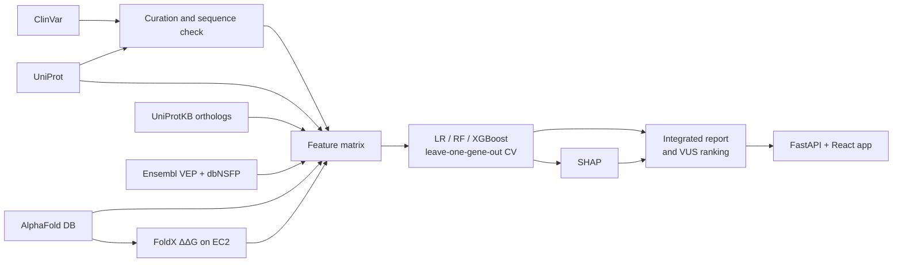
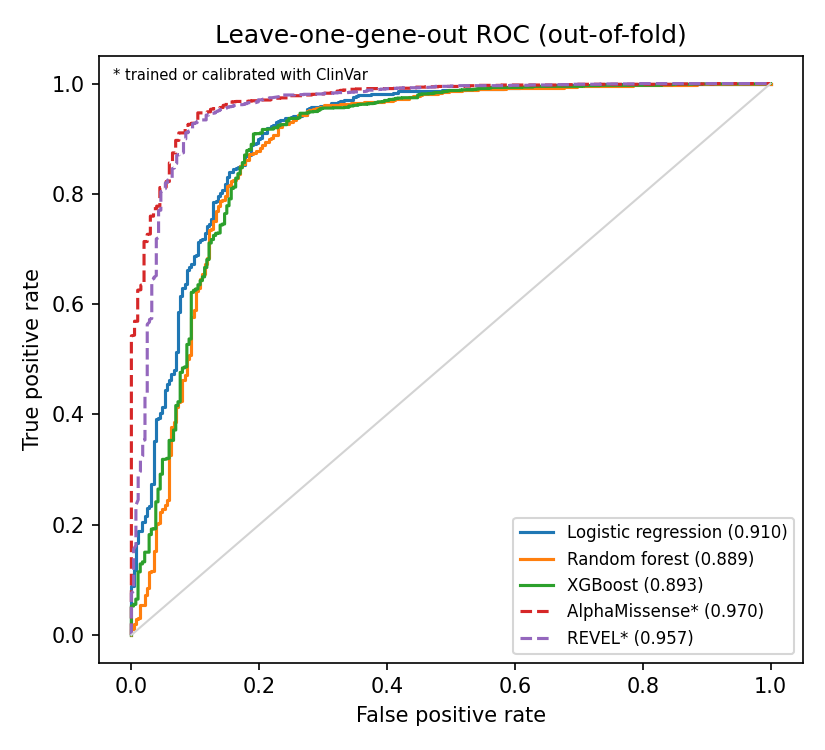
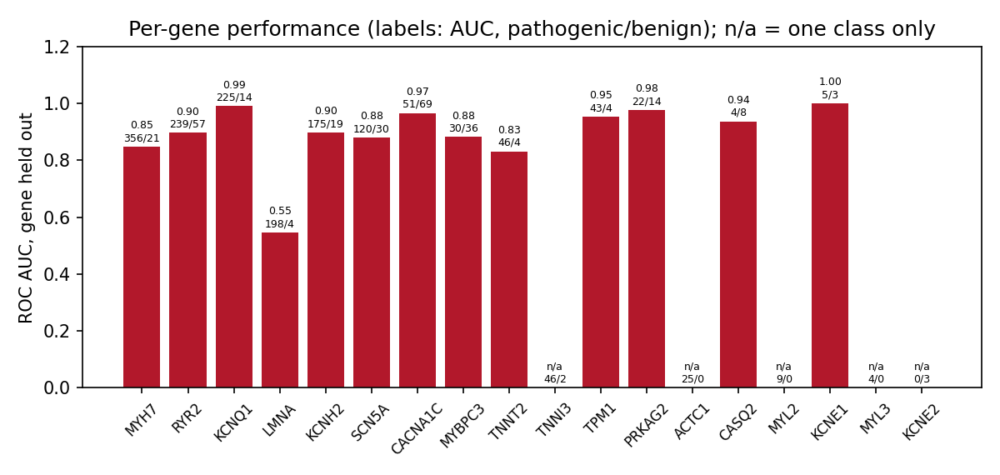
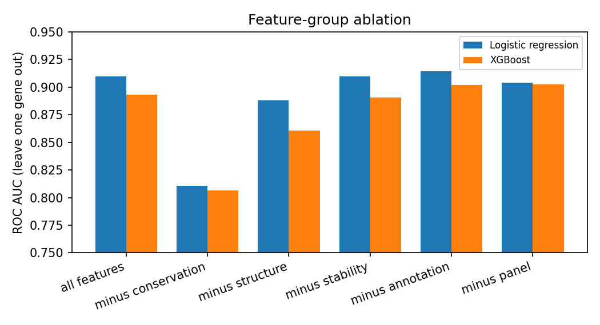
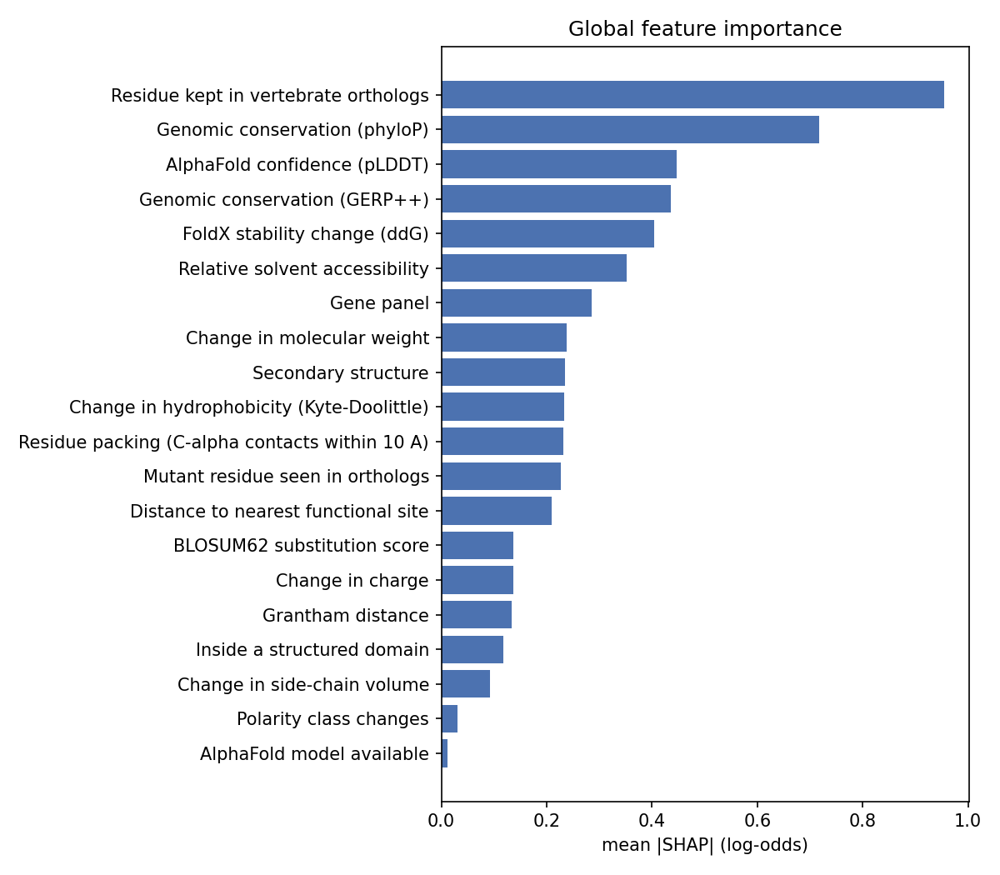
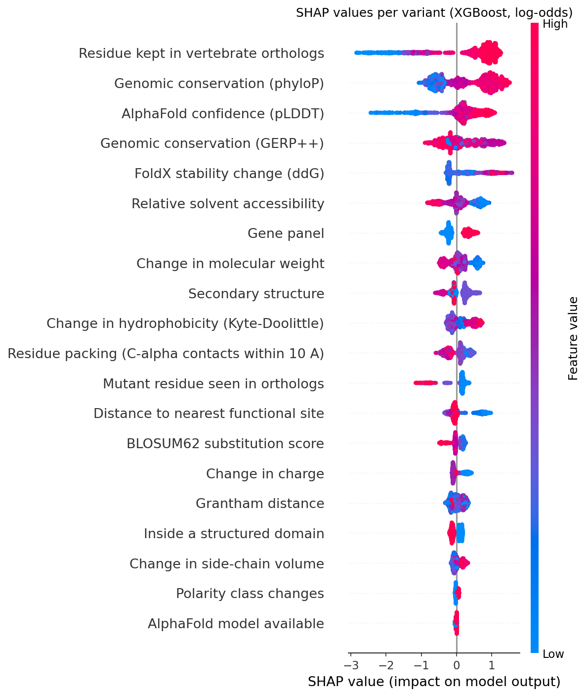
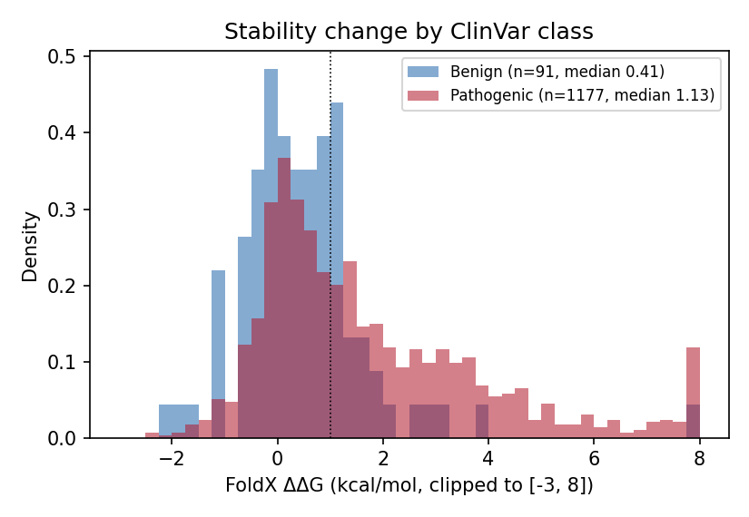
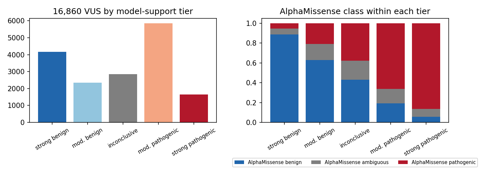

# Explainable machine learning for missense variants in inherited cardiovascular disease genes

_Biological databases course project. Authors: add team names._
_Code: branch `pipeline-phases` of this repository. Results as of 12 October 2026._

> Research prototype. Nothing in this report or the accompanying software
> is a clinical classification; model-support tiers are not ACMG/AMP classes.

## Abstract

Most missense variants in cardiomyopathy and arrhythmia genes are classified
in ClinVar as variants of uncertain significance (VUS). We built a pipeline
that assembles evidence for each missense variant in an 18-gene cardiovascular
panel from five public resources (ClinVar, UniProt, Ensembl VEP with dbNSFP,
the AlphaFold Protein Structure Database, and FoldX stability calculations on
AlphaFold models), trains interpretable classifiers on 1,886 ClinVar variants
with at least one review star, and explains each prediction with SHAP. Evaluated
by holding out one gene at a time, logistic regression reached ROC AUC 0.910
(95% CI 0.884–0.932) and XGBoost 0.893 (0.865–0.919). Conservation carried most
of the signal (removing it cost about 0.10 AUC), structural context added
0.02–0.03, and FoldX ΔΔG, although clearly shifted between classes (median
1.13 vs 0.41 kcal/mol), added almost nothing on top of the other structural
features. The model does not reach AlphaMissense (0.970) or REVEL (0.957) on the
same variants, but both were trained or calibrated with ClinVar labels and so
are optimistic here. A rule-based report combines the prediction with
independent evidence lines for every variant, and all 16,860 VUS are ranked;
on VUS, 86% of the model's strongest pathogenic calls and 89% of its strongest
benign calls agree with AlphaMissense.

## 1. Aim

Given a missense variant in one of 18 inherited cardiac disease genes:

1. predict whether it is pathogenic or benign,
2. show which pieces of biological evidence drove the prediction, and
3. add a protein-structure view of what the substitution does to the
   protein's stability.

The emphasis is on evidence that can be traced back to a database record or a
calculation, and on an honest estimate of how the model performs on genes it
has not seen.

**Gene panel** (`config/genes.yaml`). Cardiomyopathy: MYH7, MYBPC3, TNNT2,
TNNI3, MYL2, MYL3, ACTC1, TPM1, PRKAG2, LMNA. Arrhythmia: SCN5A, KCNQ1, KCNH2,
KCNE1, KCNE2, RYR2, CASQ2, CACNA1C.

## 2. Biological databases and how they were used

| Resource | Access | Retrieved | Used for |
| --- | --- | --- | --- |
| **ClinVar** (NCBI) | E-utilities: `esearch` (paged with `retstart`) and `esummary` in batches of 200 | Every missense SNV per gene: query `GENE[gene] AND "single nucleotide variant"[Type] AND "missense variant"[molecular consequence]`; 23,039 records | Labels (clinical significance, review status), protein change, SPDI genomic coordinates, rsID |
| **UniProtKB** (Swiss-Prot entries) | REST API `rest.uniprot.org/uniprotkb` | Canonical sequence and feature table for each gene's reviewed human entry | Validating every variant against the canonical sequence; domain, transmembrane, site, disorder and coiled-coil annotations |
| **UniProtKB** (vertebrate orthologs) | REST search: `gene_exact:GENE AND taxonomy_id:7742 NOT organism_id:9606` | One sequence per vertebrate species (reviewed preferred, then longest), up to 60 per gene | Ortholog conservation after BLOSUM62 global alignment to the human sequence |
| **Ensembl VEP** with **dbNSFP** and **AlphaMissense** plugins | REST `rest.ensembl.org/vep/homo_sapiens/region`, POST batches of 200 built from ClinVar SPDI | phyloP 100-way, phastCons 100-way, GERP++, SIFT, PolyPhen-2, REVEL, AlphaMissense on the MANE Select transcript (else Ensembl canonical) | Genomic conservation features; SIFT, PolyPhen-2, REVEL and AlphaMissense as comparison baselines only |
| **AlphaFold Protein Structure Database** | Prediction API (current v6 models) | Full-length predicted structure for 17 of 18 proteins (RYR2 has no single model) | Per-residue pLDDT, solvent accessibility, Cα contacts, secondary structure; input structures for FoldX; the structure viewer |
| **FoldX 5.1** (tool, academic licence) | Run on AWS EC2 against the AlphaFold models | `RepairPDB` per structure chunk, `BuildModel` per variant | Stability change ΔΔG for 8,984 variants |

Database-specific problems we had to handle:

- **ClinVar result caps.** `esearch` returns at most `retmax` IDs; without
  paging, large genes such as MYH7 (over 3,000 missense records) were silently
  truncated. Paging recovered all 23,039 records.
- **Isoform numbering.** ClinVar titles use the MANE Select transcript, while
  other ClinVar fields list protein changes on several isoforms. A position is
  accepted only if the wild-type residue matches the UniProt canonical sequence
  at that position; 252 records failed and were dropped.
- **Ortholog sparsity.** Swiss-Prot alone gave 0–12 orthologs per gene, too few
  for a conservation score; searching all of UniProtKB across Vertebrata and
  keeping one sequence per species gave 60 per gene.
- **AlphaFold DB.** Files are served only to browser-like user agents; models
  are v6; proteins over 2,700 residues (RYR2, 4,967 aa) have no single model.
- **Label circularity.** REVEL and AlphaMissense used ClinVar during training
  or calibration, so they are reported only as baselines and never used as
  model inputs.

## 3. Methods

### 3.1 Variant curation

Pipeline stage `preprocess` (`src/preprocessing/clean_variants.py`). Each
ClinVar record is parsed to a single protein substitution, validated against
the UniProt canonical sequence, and duplicate records for the same protein
change are collapsed. Pathogenic and likely pathogenic records form the positive
class, benign and likely benign the negative class. Records with conflicting
interpretations are excluded, and labelled variants need at least one review
star. Start-loss (p.Met1X) changes are removed.

| Step | Count |
| --- | ---: |
| Raw ClinVar records | 23,039 |
| Dropped: wild-type residue does not match the canonical sequence | 252 |
| Dropped: start-loss | 66 |
| Dropped: other gene, unparseable, nonsense or synonymous | 15 |
| Unique protein changes after collapsing 544 duplicates | 22,162 |
| Conflicting interpretations (excluded) | 2,315 |
| Zero-star pathogenic/benign (excluded) | 110 |
| **Labelled training set** | **1,886** (1,598 pathogenic, 288 benign) |
| VUS (held out, scored at the end) | 16,860 |



_Figure 1. Data flow._

### 3.2 Features

Twenty-nine inputs in seven groups (`src/features/`):

| Group | Features |
| --- | --- |
| Substitution | Δ hydrophobicity (Kyte–Doolittle), Δ molecular weight, Δ side-chain volume, Δ charge, polarity change, proline/glycine gain or loss, BLOSUM62 score, Grantham distance |
| Ortholog conservation | fraction of vertebrate orthologs keeping the human residue; fraction already carrying the mutant residue |
| Genomic conservation | phyloP, phastCons, GERP++ (dbNSFP via VEP) |
| Annotation (UniProt) | in structured domain, in transmembrane segment, at a functional site, distance to nearest site, in disordered region, in coiled coil |
| Structure (AlphaFold) | pLDDT; relative solvent accessibility (Shrake–Rupley SASA over Tien et al. maximum ASA); Cα contacts within 10 Å; helix/strand/coil from backbone φ/ψ, smoothed and set to coil where pLDDT < 50; model-available flag |
| Stability | FoldX ΔΔG (section 3.3) |
| Context | gene panel (cardiomyopathy or arrhythmia) |

Raw and relative residue position were tested and left out: a residue index
is not comparable across proteins, and relative position lowered
leave-one-gene-out AUC for all three models. Missing values (for example all
structural features for RYR2) are median-imputed inside each model pipeline.

### 3.3 Structure and stability (FoldX)

`src/structure/foldx_ddg.py`. FoldX `BuildModel` estimates the change in
folding free energy, ΔΔG = G(mutant) − G(wild type), positive meaning
destabilising. To make all variants feasible:

- Only variants at residues with pLDDT ≥ 70 were modelled (8,984 of 18,746;
  1,268 labelled). FoldX energies on low-confidence backbone are not
  meaningful; other variants get no ΔΔG and the model imputes it.
- Residues with pLDDT < 50 were removed from the structures.
- Proteins with more than 700 confident residues were cut into chunks: a core
  of 300 consecutive residues plus every residue whose Cα lies within 12 Å of
  the core, so each variant keeps its full local environment. This gave 39
  chunks, each repaired once with `RepairPDB`.
- One `BuildModel` run per variant. On a 10-variant test, three runs changed
  ΔΔG by at most 0.07 kcal/mol for three times the cost.

The run took 30 minutes on one `m7a.8xlarge` Spot instance (32 cores, about
15 core-hours, under US$1). The instance pulled FoldX and the inputs from a
private S3 bucket, synced results back every five minutes so an interrupted
run could resume, and terminated itself. Every planned variant returned a
value.

### 3.4 Models and evaluation

`src/modeling/`. Logistic regression (L2, C = 0.5, standardised inputs),
random forest (500 trees, minimum leaf 3) and XGBoost (300 trees, depth 3,
learning rate 0.05), all class-weighted rather than oversampled.

- **Headline evaluation: leave one gene out.** Each gene is predicted by a
  model trained on the other 17. This measures performance on a gene the model
  has not seen and stops it from scoring variants by gene identity.
- **Comparison: within-gene** stratified 5-fold cross-validation, 5 repeats.
- Metrics are computed on pooled out-of-fold predictions (several genes have
  only one class, so per-fold AUC is undefined), with 95% intervals from 1,000
  bootstrap resamples of variants.
- **Ablation:** each feature group is removed and the model re-scored with
  leave-one-gene-out CV.
- **Baselines:** SIFT, PolyPhen-2, REVEL and AlphaMissense scored on the same
  variants.
- A sigmoid-calibrated XGBoost (gene-grouped folds) provides probabilities for
  VUS.

### 3.5 Explainability

`src/explainability/shap_explain.py`. SHAP values from TreeExplainer on the
full XGBoost model, in log-odds, with one-hot columns summed back to their
source feature. As a sanity check, for features whose biological effect is
known in advance (for example, more conserved should push towards pathogenic),
the Spearman correlation between feature value and SHAP value should have the
expected sign.

### 3.6 Integrated report and VUS ranking

`src/report/generate_report.py`. For each variant the report combines the
model probability, its top SHAP contributions, and three independent evidence
lines scored by fixed thresholds:

| Evidence line | Points to pathogenic | Points to benign |
| --- | --- | --- |
| Conservation | ≥ 90% of orthologs keep the residue and phyloP ≥ 2 | mutant residue in ≥ 5% of orthologs, or < 60% keep the residue |
| Stability | ΔΔG ≥ 1 kcal/mol (≥ 2: strongly) | never (many pathogenic variants act on function, not folding) |
| Structural context | buried (RSA < 25%) at pLDDT ≥ 70 | pLDDT < 50 or annotated disordered region |

AlphaMissense (0.34 / 0.564) and REVEL (0.290 / 0.644, ClinGen calibration) are
shown for reference but not counted. The report flags disagreements, genes
with fewer than 10 benign training variants, and variants without a ΔΔG.

Probabilities are put into five model-support tiers (≥ 0.9, ≥ 0.7, 0.3–0.7,
≤ 0.3, < 0.1). The calibrated probability reflects the training mix (85%
pathogenic) and would call most VUS pathogenic for that reason alone, so tiers
use the same probability re-expressed for a 50/50 prior (odds multiplied by
0.15/0.85). For labelled variants the report uses the out-of-fold score from
the run in which the variant's gene was held out.

### 3.7 Software

A read-only FastAPI service (`api/`) and a React interface (`web/`) expose the
results: a variant explorer, the ranked VUS list, per-variant reports, the
AlphaFold model in Mol* with the variant residue focused, and the evaluation
pages. Tests: 46 (`pytest`).

## 4. Results

### 4.1 Classification performance

| Model | ROC AUC [95% CI] | PR AUC | MCC | Balanced accuracy | Recall | Specificity | Brier |
| --- | --- | --- | --- | --- | --- | --- | --- |
| **Leave one gene out** | | | | | | | |
| Logistic regression | **0.910** [0.884–0.932] | 0.976 | 0.621 | 0.848 | 0.902 | 0.795 | 0.092 |
| Random forest | 0.889 [0.859–0.918] | 0.962 | 0.636 | 0.787 | 0.968 | 0.608 | 0.072 |
| XGBoost | 0.893 [0.865–0.919] | 0.969 | 0.642 | 0.858 | 0.907 | 0.809 | 0.091 |
| **Within gene** | | | | | | | |
| Logistic regression | 0.925 [0.906–0.946] | 0.982 | 0.647 | 0.862 | 0.907 | 0.816 | 0.087 |
| Random forest | 0.929 [0.909–0.952] | 0.982 | 0.734 | 0.852 | 0.969 | 0.734 | 0.057 |
| XGBoost | 0.932 [0.914–0.954] | 0.983 | 0.689 | 0.873 | 0.927 | 0.819 | 0.068 |

_Table 1. 1,886 labelled variants, threshold 0.5. PR AUC is high mainly
because 85% of variants are pathogenic._

The gap between the two schemes is small (0.015–0.04 AUC), so the models are
not leaning heavily on gene identity. Logistic regression generalises best to
unseen genes; XGBoost is close behind and is the model explained with SHAP
because TreeExplainer is exact for it. Random forest has the highest recall but
the lowest specificity: at the default threshold it calls too many benign
variants pathogenic.



_Figure 2. Leave-one-gene-out ROC curves, with AlphaMissense and REVEL on the
same variants._

Performance varies by gene (Figure 4). It is high for KCNQ1 (0.99), CACNA1C
(0.97) and PRKAG2 (0.98), and lowest for LMNA (0.55). LMNA has 198 pathogenic
and only 4 benign variants, so its AUC rests on four points. The four benign LMNA variants are
themselves at well-conserved positions (on average 90% of orthologs keep the
residue, phyloP 4.9, against 97% and 6.3 for pathogenic ones), so the model's
main signal barely separates them. Five genes have only one class,
so AUC is undefined for them.



_Figure 4. Per-gene ROC AUC with that gene held out, labelled with
pathogenic/benign counts._

### 4.2 Comparison with published predictors

| Predictor | Coverage | ROC AUC | Our best model on the same variants |
| --- | --- | --- | --- |
| AlphaMissense | 93% | 0.970 | 0.915 |
| REVEL | 99% | 0.958 | 0.918 |
| PolyPhen-2 | 82% | 0.891 | 0.929 |
| SIFT | 84% | 0.759 | 0.921 |

Our model beats SIFT and PolyPhen-2 but not REVEL or AlphaMissense. Both of
those used ClinVar during training or calibration, so their scores on ClinVar
variants are optimistic and the comparison is not like-for-like. They also
draw on much larger training data and, for AlphaMissense, a protein language
model. Our model's value is that each prediction can be decomposed into
named, database-traceable features.

### 4.3 What the model relies on

| Removed group | Logistic regression | XGBoost |
| --- | --- | --- |
| none (all features) | 0.910 | 0.893 |
| conservation | 0.810 | 0.806 |
| structure (incl. ΔΔG) | 0.888 | 0.861 |
| FoldX ΔΔG only | 0.910 | 0.890 |
| UniProt annotation | 0.915 | 0.902 |
| gene panel | 0.904 | 0.903 |



_Figure 3. Leave-one-gene-out ROC AUC after removing each feature group._

Conservation is the backbone of the model; structure is a clear second.
UniProt annotations do not help once conservation and structure are present
(removing them slightly raises AUC, within noise). Choosing features on the
same cross-validation adds slight optimism.

SHAP agrees (Figure 5). The top features by mean |SHAP| are ortholog
conservation (0.95), phyloP (0.72), pLDDT (0.45), GERP++ (0.44), FoldX ΔΔG
(0.40) and solvent accessibility (0.35).



_Figure 5a. Global SHAP importance (XGBoost, log-odds)._



_Figure 5b. SHAP value per variant against feature value._

**Direction check.** Eight of twelve features push in the biologically
expected direction: ortholog conservation (ρ = +0.88), phyloP (+0.86), pLDDT
(+0.87) and ΔΔG (+0.54) towards pathogenic; BLOSUM62 (−0.90), solvent
accessibility (−0.85), mutant residue seen in orthologs (−0.52) and
disordered region (−0.51) towards benign. The four exceptions (GERP++,
phastCons, Grantham, contact count) are each strongly correlated with a
stronger feature (phyloP, BLOSUM62, solvent accessibility); the trees use them
as residual corrections, so their marginal direction is not interpretable on
its own. Monotonic constraints forcing the expected direction cost about 0.01
AUC and were not used.

### 4.4 Stability



_Figure 6. FoldX ΔΔG for the 1,268 labelled variants at confident residues._

Pathogenic variants are more destabilising (median 1.13 kcal/mol, long
right tail; proline substitutions in helices such as LMNA L35P, R41P and R48P
reach +3 to +4.4) than benign ones (median 0.41). On its own ΔΔG reaches ROC AUC
0.68 on these variants. In the model it ranks fifth by SHAP and points the
expected way, yet removing it changes leave-one-gene-out AUC by only 0.000
(logistic regression) to 0.003 (XGBoost). The information ΔΔG carries, that
buried, well-packed residues in folded regions do not tolerate change, is
already present in solvent accessibility, contact count, pLDDT and
conservation. Many pathogenic cardiac variants also act through function
(myosin motor activity, channel gating, protein–protein interfaces) rather
than folding, which a single-chain stability calculation does not see.

### 4.5 VUS prioritisation



_Figure 7. Left: 16,860 VUS by model-support tier. Right: AlphaMissense class
within each tier._

| Tier | VUS |
| --- | ---: |
| Strong support for pathogenic | 1,654 |
| Moderate support for pathogenic | 5,850 |
| Inconclusive | 2,857 |
| Moderate support for benign | 2,342 |
| Strong support for benign | 4,157 |

Two checks suggest the tiers are meaningful. On labelled variants (scored
out-of-fold), 97% of strong-pathogenic calls are ClinVar pathogenic and 12% of
strong-benign calls are (against 85% overall). On VUS, AlphaMissense, which
our model never sees, agrees with 86% of strong-pathogenic and 89% of
strong-benign calls. The top-ranked VUS combine full ortholog conservation,
high genomic conservation and strong destabilisation, for example KCNQ1 E284G
(ΔΔG +4.2), MYH7 Y142C (+3.4) and ACTC1 R256P (+6.7). Probabilities saturate
at about 0.91 at the top, so ranks inside the strongest tier are effectively
ties. The full ranked list is `outputs/reports/vus_report.csv`, with complete
reports for the top 50 in `vus_top50.md`.

**Worked example: MYH7 R403Q**, the classic hypertrophic cardiomyopathy
variant. Scored with MYH7 held out, P = 0.74 (moderate support for
pathogenic). The residue is kept in all vertebrate orthologs (phyloP 7.8);
FoldX gives +1.46 kcal/mol (destabilising); it sits in the myosin motor
domain, 50% solvent exposed on a strand. Conservation and stability agree
with the model, and AlphaMissense (0.87) and REVEL (0.89) concur. The full
model, which has seen other MYH7 variants, gives 0.97; the gap illustrates why
the held-out score is the honest one.

## 5. Discussion

A small, transparent model built from public databases gets within about 0.06
AUC of state-of-the-art predictors on unseen genes, and every prediction can
be explained in terms a geneticist would recognise: is the residue conserved
across vertebrates, is it buried in a confidently folded region, does the
substitution destabilise the fold. The largest single lesson is that
evaluation design dominates the numbers. Early versions of the pipeline,
trained on a ClinVar pull truncated by the API's result cap and evaluated with
a single random split, reported ROC AUC around 0.56–0.59; complete data and a
gene-held-out evaluation with confidence intervals changed both the result and
how much it can be trusted.

The structural analysis was the most expensive part and the least decisive.
Stability changes are real and visible in the data, but conservation and
simple structural context already encode most of the same information.
Structure is more useful for explanation than for accuracy: a ΔΔG of +4 kcal/mol
in a buried helix is a concrete mechanism to show alongside a prediction.

## 6. Limitations

- **Label noise and class imbalance.** ClinVar labels come from many
  submitters with different standards; benign missense variants in these
  genes are rarely submitted (288 benign against 1,598 pathogenic), and
  several genes have fewer than five. Specificity estimates are correspondingly
  uncertain, and per-gene AUCs for LMNA, TNNT2 and similar genes rest on a
  handful of benign variants.
- **Ascertainment.** Labelled variants are those that clinicians chose to
  submit and review; VUS may differ systematically (for example rarer, or in
  less-studied regions), so performance on VUS may be lower than on ClinVar.
- **Circular baselines.** REVEL and AlphaMissense used ClinVar; their scores
  here overstate their accuracy on new variants.
- **Predicted structures.** AlphaFold models are of the wild type only and are
  largely insensitive to single substitutions, so we did not compare mutant
  and wild-type predicted structures (an RMSD would be near zero by
  construction). RYR2, the largest gene and 296 labelled variants, has no
  model; its structural features are imputed.
- **FoldX approximations.** Single chains, no membrane, no binding partners
  (myosin–actin, channel tetramers and β-subunits are absent), one run per
  variant, large proteins cut into chunks, and only residues with pLDDT ≥ 70.
  FoldX's own error is about 1 kcal/mol. Destabilisation at interfaces is
  underestimated, and variants acting through function rather than folding
  are invisible to it.
- **Probability scale.** The calibrated probability reflects the training
  mix; the balanced-prior version used for tiers assumes a 50/50 prior, which
  is a convention, not a measured VUS prevalence. Treat tiers as a ranking.
- **Feature selection on the evaluation folds** (dropping relative position,
  choosing structure features) adds slight optimism to the reported AUCs.
- **Not a clinical tool.** The model does not implement ACMG/AMP criteria,
  ignores segregation, population frequency and functional assays, and must
  not be used for diagnosis.

## 7. Reproducing the results

```bash
pip install -r requirements.txt
python -m src.pipeline --stage collect      # ClinVar, UniProt (~20 min)
python -m src.pipeline --stage preprocess
python -m src.pipeline --stage annotate     # orthologs, AlphaFold, VEP (~1 h)
python -m src.structure.foldx_ddg prepare   # then run on a FoldX machine, see README
python -m src.structure.foldx_ddg collect
python -m src.pipeline --stage features
python -m src.pipeline --stage train
python -m src.pipeline --stage explain
python -m src.pipeline --stage report
python -m src.report.figures                # figures in this document
pytest -q
```

Random seed 42 throughout. Network-dependent stages reflect the databases on
the day they were run (ClinVar, UniProt and AlphaFold DB are updated
continually). FoldX requires an academic licence and is not in the
repository.

## 8. Conclusion

Combining ClinVar labels with UniProt, Ensembl VEP/dbNSFP and AlphaFold DB
gives an interpretable classifier for cardiovascular missense variants with
leave-one-gene-out ROC AUC of about 0.91, explanations that match known
biology, and a ranked, evidence-annotated list of all 16,860 VUS. Evolutionary
conservation is the dominant signal; protein structure adds a modest but
consistent improvement; and FoldX stability, while clearly different between
classes, is mostly redundant with simpler structural features.

## References

- Landrum MJ et al. ClinVar: improving access to variant interpretations and supporting evidence. *Nucleic Acids Res* 2018;46:D1062–D1067.
- The UniProt Consortium. UniProt: the Universal Protein Knowledgebase in 2023. *Nucleic Acids Res* 2023;51:D523–D531.
- McLaren W et al. The Ensembl Variant Effect Predictor. *Genome Biol* 2016;17:122.
- Liu X et al. dbNSFP v4: a comprehensive database of transcript-specific functional predictions and annotations for human nonsynonymous and splice-site SNVs. *Genome Med* 2020;12:103.
- Jumper J et al. Highly accurate protein structure prediction with AlphaFold. *Nature* 2021;596:583–589.
- Varadi M et al. AlphaFold Protein Structure Database in 2024. *Nucleic Acids Res* 2024;52:D368–D375.
- Schymkowitz J et al. The FoldX web server: an online force field. *Nucleic Acids Res* 2005;33:W382–W388.
- Delgado J et al. FoldX 5.0: working with RNA, small molecules and a new graphical interface. *Bioinformatics* 2019;35:4168–4169.
- Cheng J et al. Accurate proteome-wide missense variant effect prediction with AlphaMissense. *Science* 2023;381:eadg7492.
- Ioannidis NM et al. REVEL: an ensemble method for predicting the pathogenicity of rare missense variants. *Am J Hum Genet* 2016;99:877–885.
- Pejaver V et al. Calibration of computational tools for missense variant pathogenicity classification and ClinGen recommendations for PP3/BP4 criteria. *Am J Hum Genet* 2022;109:2163–2177.
- Pollard KS et al. Detection of nonneutral substitution rates on mammalian phylogenies. *Genome Res* 2010;20:110–121.
- Siepel A et al. Evolutionarily conserved elements in vertebrate, insect, worm, and yeast genomes. *Genome Res* 2005;15:1034–1050.
- Davydov EV et al. Identifying a high fraction of the human genome to be under selective constraint using GERP++. *PLoS Comput Biol* 2010;6:e1001025.
- Tien MZ et al. Maximum allowed solvent accessibilities of residues in proteins. *PLoS One* 2013;8:e80635.
- Grantham R. Amino acid difference formula to help explain protein evolution. *Science* 1974;185:862–864.
- Henikoff S, Henikoff JG. Amino acid substitution matrices from protein blocks. *PNAS* 1992;89:10915–10919.
- Chen T, Guestrin C. XGBoost: a scalable tree boosting system. *KDD* 2016.
- Lundberg SM, Lee S-I. A unified approach to interpreting model predictions. *NeurIPS* 2017.
- Lundberg SM et al. From local explanations to global understanding with explainable AI for trees. *Nat Mach Intell* 2020;2:56–67.
- Richards S et al. Standards and guidelines for the interpretation of sequence variants (ACMG/AMP). *Genet Med* 2015;17:405–424.
